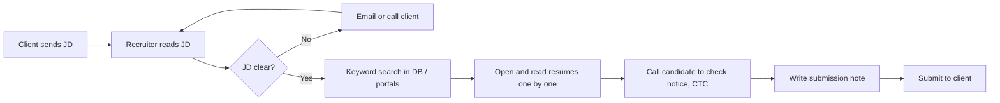
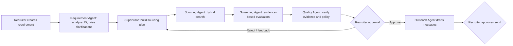

# Requirements Gathering — TalentScout Agentic Recruitment Command Centre

| Item | Value |
|---|---|
| Document owner | Product Owner (PO) |
| Status | Draft v0.1, Sprint 0 |
| Last updated | 2026-11-27 |
| Approvers | HR Guru Director (sponsor), Delivery Lead |

## 1. Why we are doing this

HR Guru is a recruitment business. Its recruiters spend most of their day on repetitive work:
- reading job descriptions (JDs) and chasing clients for missing details;
- searching the candidate database with keyword guesses;
- reading resumes to check whether a candidate really matches;
- writing outreach messages one at a time;
- chasing ageing requirements.

Resume parsing, JD parsing and a recruitment platform frontend already exist. This project is **not another ATS (applicant tracking system)**. It adds an **agentic layer**: a supervised team of AI agents that plans and carries out the sourcing-to-shortlist workflow. Recruiters stay in control of every decision that leaves the building.

## 2. Stakeholders

| Stakeholder | Role in project | Interest | Influence | Engagement |
|---|---|---|---|---|
| HR Guru Director | Sponsor, budget owner | Faster delivery, more placements per recruiter | High | Monthly steering, sprint review |
| Delivery Lead | Key user and SME | SLA adherence, submission quality | High | Every sprint review, backlog refinement |
| Recruiters (pilot group) | Primary users | Less manual sourcing, better shortlists | Medium | Interviews, UAT (user acceptance testing), feedback capture |
| Client hiring managers | Indirect beneficiaries | Quality and speed of submissions | Medium | Not directly involved in MVP |
| Candidates | Data subjects | Privacy, fair treatment, relevant outreach | Low (high ethically) | Consent notice, opt-out |
| Data Protection contact | Compliance | DPDP Act 2023 compliance | High (veto) | Sign-off before pilot with real data |
| Product Owner / Architect / Tech Lead | Delivery team (you plus AI-assisted dev) | Working MVP, learning, interview story | — | Daily |

## 3. Personas

**P1 — Riya, Recruiter (3 years' experience)**
- Handles about 6 open requirements at once.
- Spends about 2–3 hours a day on database searches and resume reading.
- Pain: "I search 'AWS architect' and get 400 results, half of them developers."

**P2 — Arjun, Delivery Lead**
- Owns SLAs for 4 clients.
- Pain: "I find out a requirement is stuck only when the client complains."

**P3 — Meera, Director**
- Wants to grow revenue without growing headcount.
- Needs proof that AI is safe to use with candidate data.

## 4. Discovery questions and current answers

These questions were sent to the business on 2026-11-27. Until we get answers, the values below are **working assumptions**. Each is logged in the RAID log (A-xx) and must be validated before Sprint 2 planning.

| # | Question | Working assumption | Status |
|---|---|---|---|
| Q1 | How many recruiters and delivery leads? | 10 recruiters, 2 delivery leads | **Assumption A-01** |
| Q2 | Open requirements per month, number of clients? | ~60 per month, ~15 active clients | **Assumption A-02** |
| Q3 | Candidate sources and database size? | Own DB of ~50,000 profiles plus licensed portal exports | **Assumption A-03** |
| Q4 | Existing parsers: language and database? | Python parsers that output JSON; to be wrapped as tools | **Assumption A-04** |
| Q5 | Top 3 pain points? | Time to first submission, rejected submissions, ageing requirements | **Assumption A-05** |
| Q6 | KPIs tracked today? | Time to first submission, submission-to-interview ratio, SLA breaches | **Assumption A-06** |
| Q7 | LLM providers allowed and AI budget? | **$0 cash**: free tiers plus a local model (decided) | **Decision D-01** |
| Q8 | Deployment target? | Local Docker Compose (primary), OCI Always Free (optional) | **Decision D-02** |

## 5. Interview guide (use with 3 recruiters and 1 delivery lead)

1. Walk me through the last requirement you worked on, from receiving the JD to the first submission.
2. Where did you lose the most time? What did you do to work around it?
3. How do you decide that a candidate is a "real" match? What evidence do you look for?
4. What makes you reject a profile that looked good on paper?
5. What information is usually missing from client JDs?
6. How do you write outreach messages today? What is your response rate?
7. Which tasks would you **never** let an AI do without you checking?
8. If this tool saved you 2 hours a day, what would you do with that time?

Record the answers in `docs/00-discovery/interview-notes/` (one file per interview, **no candidate names**).

## 6. Current-state process (as-is)

**Measured pain (to validate):** steps E–G take about 70% of recruiter time per requirement.

## 7. Future-state process (to-be)

## 8. Constraints captured

- **C1 — Zero cash budget.** Only free tiers, open-source software and the local machine (MacBook M2, 16 GB).
- **C2 — Candidate PII must never reach a free cloud LLM tier.** Free tiers may use data to improve the provider's products. Real PII is processed only by a local model.
- **C3 — No autonomous external actions.** Sending messages and rejecting candidates always need a human.
- **C4 — Authorised sources only.** HR Guru's database, licensed exports and direct applicants. No scraping.
- **C5 — Public repository.** Only synthetic data is committed. Real data stays outside git.
