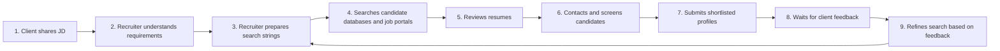
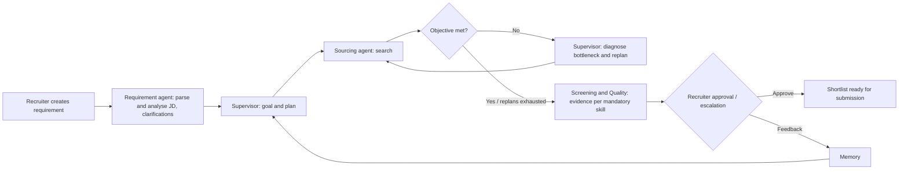

# Requirements Gathering: HR Guru Agentic AI Recruitment Command Centre

| Item | Value |
|---|---|
| Codename / repo | TalentScout (`talentscout-agentic-hr`) |
| Document owner | Product Owner (PO) |
| Status | v0.2: updated with the business brief of 2026-11-27 |
| Approvers | HR Guru Director (sponsor), Delivery Lead |

## 1. Business background

HR Guru provides **recruitment and resource augmentation services** to multiple enterprise clients, with about **40 recruitment professionals**.

The current process depends heavily on:
- manual activities;
- individual recruiter experience;
- repetitive decision-making.

There is an opportunity to improve recruiter productivity, candidate quality and delivery efficiency with agentic AI.

This is a **separate repository and platform**. The existing recruitment platform is not modified. Its JD and resume parsing components may be reused after a code review (TS-E1-08).

## 2. Stakeholders

| Stakeholder | Role in project | Interest | Influence | Engagement |
|---|---|---|---|---|
| HR Guru Director | Sponsor, budget owner | Productivity, quality, delivery efficiency | High | Phase gates, sprint review |
| Delivery Lead(s) | Key users and SMEs | Submission quality, conversion, SLAs | High | Sprint reviews, backlog refinement |
| Recruiters (~40 professionals; pilot group of 3–5) | Primary users | Less manual sourcing, better shortlists | Medium | Interviews, UAT, feedback |
| Enterprise clients | Indirect beneficiaries | Relevant submissions, faster closure | Medium | Not involved in MVP |
| Candidates | Data subjects | Privacy, fair treatment | Low (high ethically) | Consent notice, erasure |
| Data protection contact | Compliance | DPDP Act 2023 | High (veto) | Sign-off before real data is used |
| Delivery team (PO / architect / tech lead / developer, AI-assisted) | Builds the MVP | Working, governed MVP | — | Daily |

## 3. Personas

**P1 — Riya, Recruiter.** Works several open requirements at once. Builds search strings by hand and reads dozens of resumes per requirement.
> "Half the profiles I find fail on notice period or budget after I've read them."

**P2 — Arjun, Delivery Lead.** Accountable for submission quality and conversion.
> "Quality depends on who worked the requirement, and the same mistakes repeat because client feedback arrives late."

**P3 — Meera, Director.** Wants measurable productivity gains and proof that AI is used safely with candidate data.

## 4. Current workflow (AS-IS)

## 5. Business problems

| # | Problem | Business impact | Addressed in MVP by |
|---|---|---|---|
| BP-1 | Incorrect understanding of JD | Irrelevant submissions | Requirement agent: structured analysis, ambiguities, clarification questions |
| BP-2 | Manual candidate sourcing | High recruiter effort | Sourcing agent: hybrid search with replanning |
| BP-3 | Dependency on recruiter experience | Inconsistent quality | Standardised evidence-based matching; long-term memory of approved feedback |
| BP-4 | Repetitive resume screening | Reduced productivity | Resume parsing plus evidence-based matching (Screening and Quality agents) |
| BP-5 | Delayed client feedback | Repeated mistakes | Feedback captured into agent memory and reused in later searches |
| BP-6 | Limited intelligence on talent availability | Longer closure timelines | Funnel analysis and bottleneck diagnosis per search (UC-001); deeper talent intelligence is future (A2A, Sprint 6 stretch) |
| BP-7 | Quantity-driven submissions | Lower conversion ratios | Quality-over-quantity objective ("5 evidenced candidates"); Quality agent |
| BP-8 | Manual delivery monitoring | Reactive management | Partly: agent execution dashboard. A Delivery agent is a **future phase** |

## 6. Proposed solution (TO-BE)

A goal-driven AI platform that plans and executes recruitment tasks **independently, within approved boundaries**. Recruiters remain responsible for hiring decisions.

The reference scenario is [UC-001: Intelligent Candidate Sourcing](UC-001-intelligent-candidate-sourcing.md).

## 7. Discovery questions

| # | Question | Current answer | Status |
|---|---|---|---|
| Q1 | Team size and split | ~40 recruitment professionals (confirmed). Split between recruiters and delivery leads TBC | **Partly confirmed (A-01)** |
| Q2 | Open requirements per month, number of clients | Planning figure 200 per month (≈ 5 per recruiter); multiple enterprise clients | **Assumption A-02** |
| Q3 | Candidate sources and database size | Internal candidate database and job portals; Naukri only with authorised API access | **Partly confirmed (A-03)** |
| Q4 | Existing JD and resume parsers: language, quality, reusability | Exist; reuse subject to code review | **Confirmed exists; review TS-E1-08** |
| Q5 | Top pain points | BP-1 … BP-8 (§5) | **Confirmed** |
| Q6 | KPIs tracked today | Baseline to be established before measuring (TS-E0-08) | **Open** |
| Q7 | AI budget | $0 cash: free tiers plus local model | **Decision D-01** |
| Q8 | Deployment target | Local Docker Compose first; OCI Always Free optional | **Decision D-02** |

## 8. Interview guide (3–5 recruiters, 1–2 delivery leads)

1. Walk me through your last requirement, from JD to first submission.
2. Where did you lose the most time? What workaround did you use?
3. How do you decide that a candidate is a real match? What evidence do you look for?
4. What usually makes a client reject a submitted profile?
5. What information is usually missing from client JDs?
6. When a search returns too few candidates, what do you try next? (This informs the replanning strategies.)
7. Which tasks would you **never** let an AI do without checking?

Record the answers in `docs/00-discovery/interview-notes/`, one file per interview, with **no candidate names**.

## 9. Constraints

- **C1 — Zero cash budget.** Free tiers, open source and the local MacBook M2 16 GB only.
- **C2 — Candidate PII never goes to a free cloud LLM tier.** Real PII is processed by local models only.
- **C3 — Bounded autonomy.** No autonomous hiring decisions, no autonomous relaxing of constraints, no candidate contact in the MVP.
- **C4 — Authorised sources only.** Internal database, licensed exports, direct applicants. Naukri only via authorised API.
- **C5 — Synthetic or properly authorised data** during development. Only synthetic data is committed (public repository).
- **C6 — No unnecessary frameworks** just to demonstrate newer technology.
- **C7 — Separate repository.** The existing recruitment platform is not modified.
