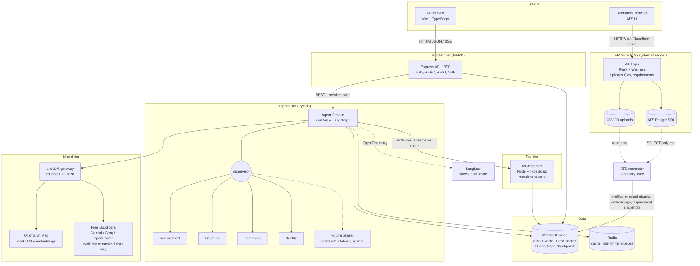
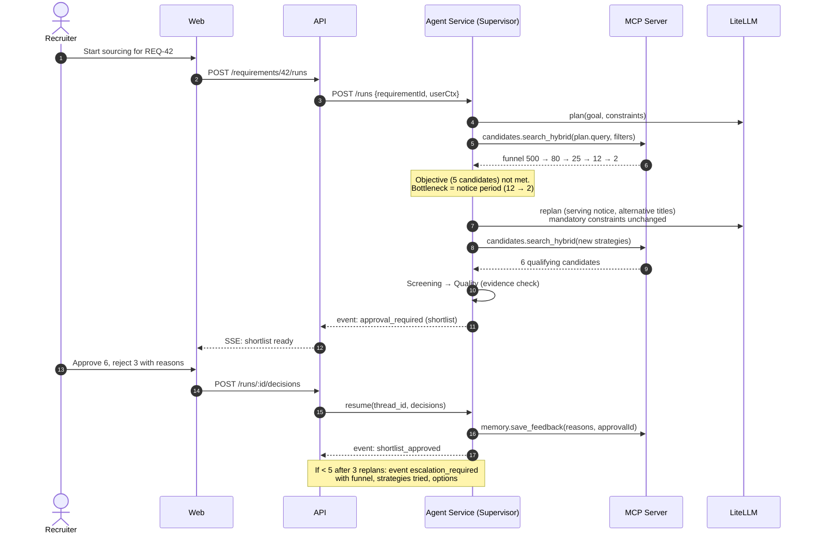

# High-Level Design (HLD)

Version 0.3. Architecture decisions are recorded in [adr/](adr/). The HR Guru ATS is the system of record for candidates, CVs and requirements ([ADR-0006](adr/0006-monorepo-with-hr-guru-ats.md), [ADR-0007](adr/0007-ats-as-system-of-record.md)).

## 1. Architecture at a glance

**Why three tiers?** ([ADR-0001](adr/0001-hybrid-mern-plus-python-agents.md))
- The **product tier** stays MERN: React, Express, MongoDB, Node. It owns users, RBAC and the UI.
- The **agentic tier** uses Python because the agent ecosystem (LangGraph checkpointing, Langfuse, Ragas, DeepEval) is most mature there.
- The **MCP server** is the *only* way agents touch business data. Agents never get database credentials, so tool permissions are enforced in one place.

## 2. Components

| Component | Tech | Responsibility | Owns data |
|---|---|---|---|
| HR Guru ATS | Flask, Waitress, PostgreSQL 16, server-rendered templates | Live recruiter system: candidate and CV upload (including Naukri-sourced candidates), requirements, submissions, reports. Restored to run locally in Docker and exposed through Cloudflare Tunnel | candidates, CVs, requirements, submissions (**source of truth**) |
| ATS connector | Python, in the agent service | Incremental read-only sync from the ATS (`updated_at`), resume parsing via the ATS parser, PII masking, embeddings; deletion propagation | — (writes derived data to MongoDB) |
| Web | React 19, Vite, TypeScript, TanStack Query | UI for requirements, agent execution dashboard (live run view, run history, KPIs), shortlist review, approvals | — |
| API / BFF | Node 22, Express 5, Zod, Mongoose | Auth (JWT plus refresh), RBAC, CRUD, approval endpoints, proxying run events to the UI over Server-Sent Events (SSE), audit writes | users, requirements, approvals |
| Agent Service | Python 3.12, FastAPI, LangGraph, Pydantic | Run orchestration, agents, guardrails, model calls, checkpointing | runs, checkpoints |
| ATS parsers (reused) | Python (`ats_pipeline.py`, `app.py` parse functions, `skill_aliases.py`) | JD and resume parsing, wrapped as `jd.parse` / `resume.parse` tools | — |
| MCP Server | Node 22, `@modelcontextprotocol/sdk` | Typed, permissioned tools over recruitment data; enforces tool scopes per agent | — (reads/writes via the data layer) |
| LiteLLM | Python (OSS) | Single model interface, routing rules, fallbacks, retries, budgets | — |
| Ollama | Native on macOS | Local LLM (8B class) and embedding model; the PII-safe path | — |
| MongoDB Atlas (free) / atlas-local (dev) | — | Documents, `$vectorSearch`, `$search` (BM25), checkpoints | all persistent |
| Redis | Docker | Response cache, token-bucket rate limiter for free tiers, job queue | ephemeral |
| Langfuse | Cloud Hobby (free) | Traces, prompt versions, evaluation scores, cost | traces (masked) |

## 3. Key flows

### 3.1 Sourcing run (happy path with a replan)

### 3.2 Failure and resume
1. Every LangGraph node transition is checkpointed to MongoDB (`thread_id = run_id`).
2. A free tier returns 429. LiteLLM tries the next provider, then falls back to local Ollama.
3. If every provider fails, the node raises `RetryLater`. The run status becomes `paused_rate_limited` and a scheduled retry resumes from the last checkpoint. No step is repeated, because tool calls carry idempotency keys.

## 4. Model routing ([ADR-0004](adr/0004-zero-cost-model-routing.md))

| Task class | Data sensitivity | Route | Fallback |
|---|---|---|---|
| Embeddings | Any | Ollama `nomic-embed-text` (local) | — |
| JD / resume extraction, screening | **Real PII** | Ollama 8B local only | Pause and retry (never cloud) |
| Planning, reflection, Quality | Synthetic or masked | Free cloud tier (Gemini Flash / Groq) | Next free provider → Ollama |
| Evaluation judge | Synthetic only | Free cloud tier | Ollama |

The **data classification tag** travels with every request (`pii: true|false`). The router **refuses** to send `pii: true` to a cloud route. Unit tests cover this; it is a release-blocking control.

## 5. Security architecture

| Layer | Controls |
|---|---|
| Edge / API | Helmet headers, CORS allow-list, rate limiting, Zod validation on every input, JWT (15 min) plus rotating refresh token, RBAC middleware, CSRF protection on cookie routes |
| Service-to-service | Shared service token (dev) → mTLS or signed JWT (pilot); agent service is not exposed publicly |
| Agents | Untrusted-content wrapping for resumes and JDs (treated as data, not instructions); allow-listed tools per agent; argument schema validation; approval tokens for side-effecting tools; loop, time and token limits |
| ATS boundary | TalentScout uses a `SELECT`-only database role; no TalentScout code path writes to ATS tables; connector contract tests; the ATS is published only through Cloudflare Tunnel with HTTPS |
| Data | PII masking before any cloud call; encryption at rest (Atlas); field-level separation of protected attributes; retention job; erasure endpoint |
| Supply chain | Lockfiles, Dependabot, CodeQL, Semgrep, npm audit / pip-audit, gitleaks, Trivy image scans, SBOM |
| Audit | Append-only audit events; every approval linked to user and time |

Threat model (STRIDE plus OWASP LLM Top 10): [threat-model.md](threat-model.md).

## 6. Deployment views

**ATS (live, from Sprint 0):** on the same Mac in Docker (`ats`, `ats-db`). Recruiters reach it at `https://ats.hrgp.in` through a Cloudflare Tunnel (no public IP). Nightly `pg_dump` plus uploads backup. See the [runbook](../runbooks/ats-local-restore.md).

**Dev and pilot (primary):** MacBook M2 16 GB.
- `docker compose up` runs web, api, agents, mcp, mongo (atlas-local), redis and litellm.
- Ollama runs **natively** so it can use the Metal GPU. Containers reach it through `host.docker.internal:11434`.

**Demo (optional):** OCI Always Free ARM VM (2 OCPU / 12 GB as of June 2026). It runs web, api, agents and mcp as containers from GHCR. MongoDB Atlas free and Langfuse Cloud Hobby are managed. The demo uses **synthetic data only** and cloud model routes (there is no GPU for local models).

**CI/CD:** GitHub Actions.
- PR checks: lint, unit, integration, evaluations, security scans.
- On merge to `main`: images are built, scanned and pushed to GHCR. The demo VM deploys if its secrets are configured.

## 7. Quality attributes and tactics

| Attribute | Tactic |
|---|---|
| Reliability | Checkpointing, idempotent tools, retries, provider fallback |
| Cost | Cache, small context, local model for bulk work, token budgets, notional cost tracking |
| Explainability | Evidence citations, persisted plans, trace links in the UI |
| Fairness | Protected-attribute masking, job-relevant criteria only, fairness evaluation (counterfactual name swap) |
| Evolvability | MCP decouples tools; LiteLLM decouples models; A2A for external agents |

## 8. Technology versions (baseline 2026-11-27)

Node 22 LTS, Express 5, React 19 + Vite 8, Python 3.12, FastAPI 0.16x, LangGraph 1.2.x, MCP TypeScript SDK 1.32.x, MongoDB 8 (Atlas), Redis 7. Exact versions are pinned in lockfiles.
